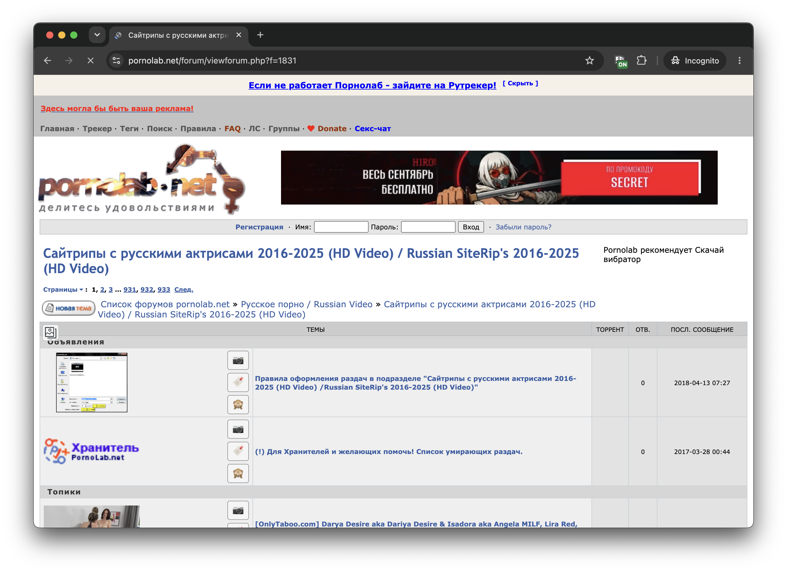
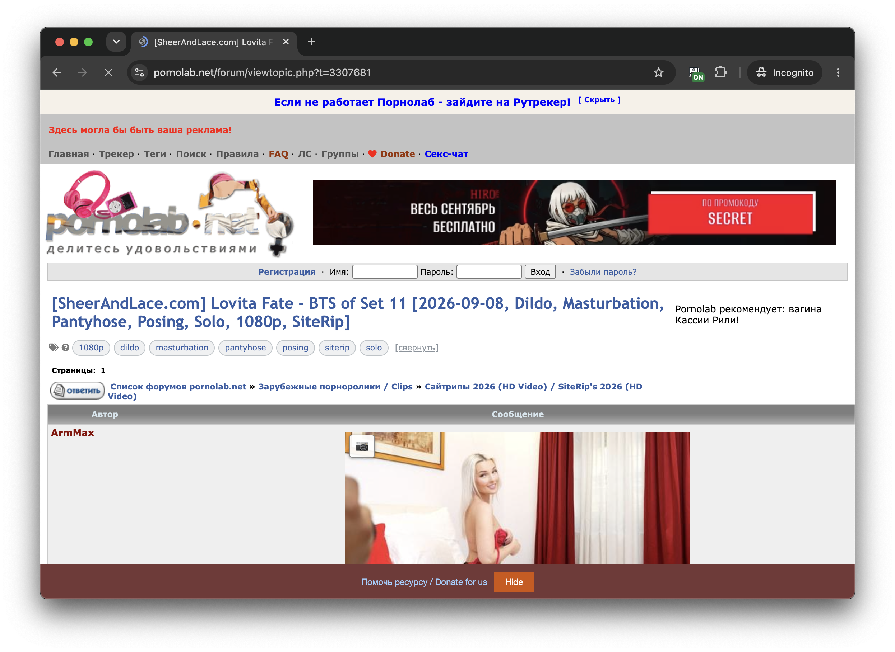
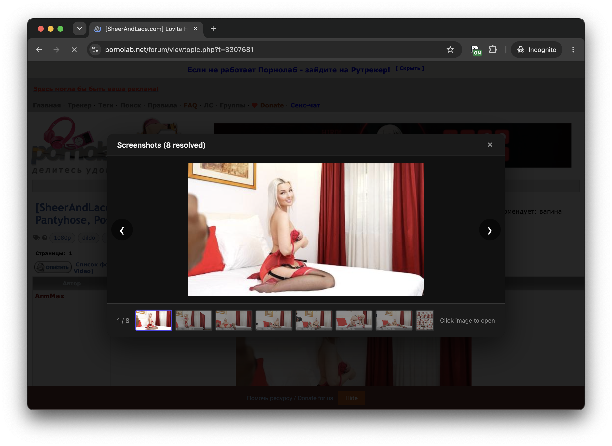
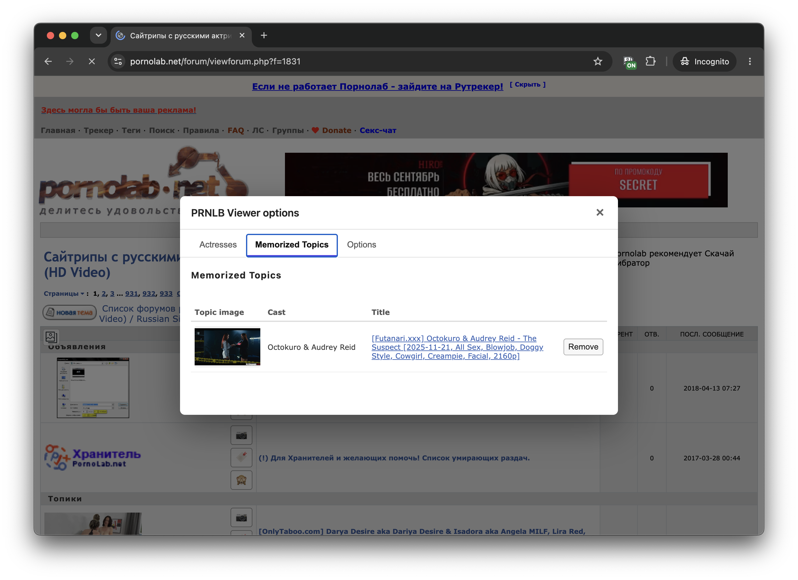
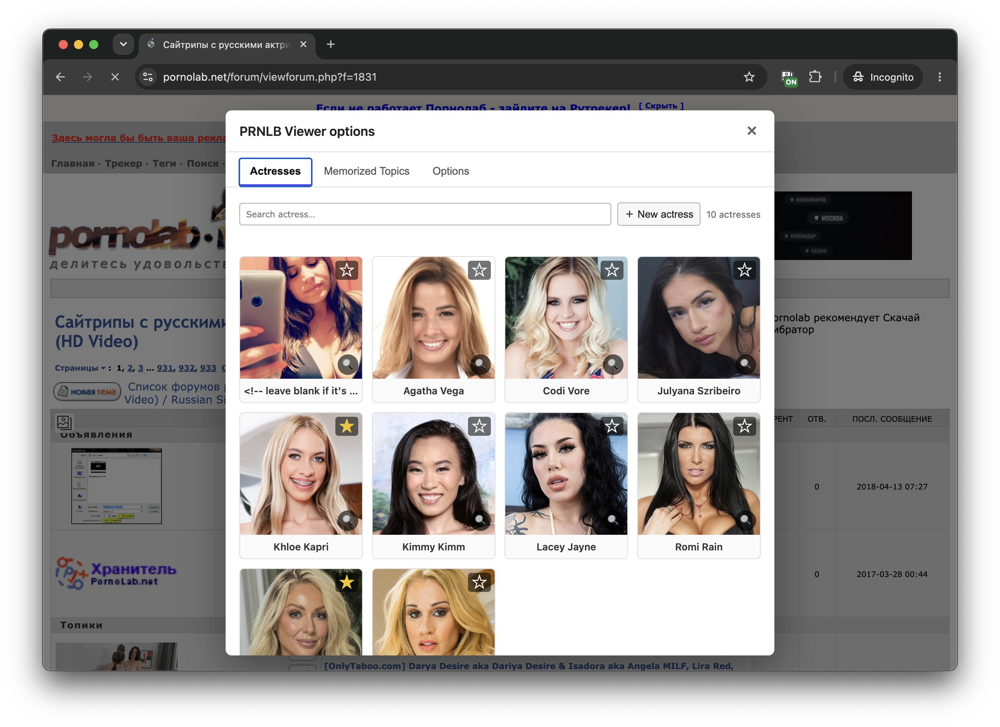
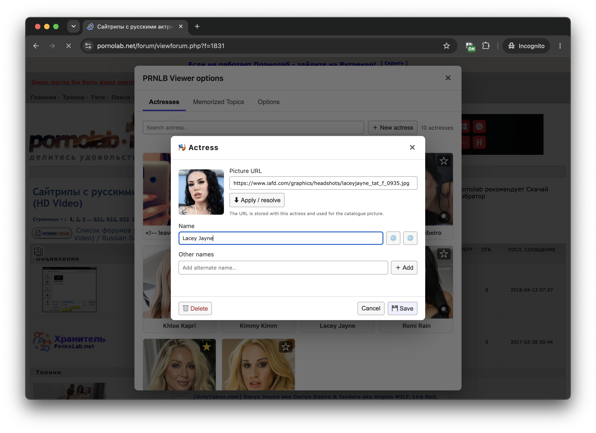

# PRNLB Viewer

PRNLB Viewer is a Chrome and Firefox extension for extracting image links from supported Pornolab pages and displaying the corresponding screenshots.

It activates automatically on supported Pornolab pages while enabled (the default):

- On a topic page (`viewtopic.php`), it adds controls to the first post image: a 📷 button opens the screenshot carousel, a 🔖 button memorizes the topic, and an options button opens the settings dialog. The carousel resolves images progressively and supports keyboard navigation; clicking an image opens the resolved image in a new tab.
- On forum and tracker topic lists (`viewforum.php` and `tracker.php`), including tracker search-result tables, it adds a first-post image preview, cast links, screenshot, memorize, and hide/show controls to each topic row. The screenshot button opens the same carousel for that topic.
- Memorized topics are stored locally. The Memorized Topics options tab shows each topic's image, cast, and clickable title, and allows it to be removed.
- The options dialog also includes an Actresses catalogue with search, aliases, favorites, editable picture URLs, and Boobpedia/IAFD lookup. Actress search buttons open a new Pornolab tracker search tab, and catalogue matches can highlight topic rows.
- Topic-list settings can restrict the extension to topic pages, hide or show previously hidden topics, and enable or disable actress highlighting. These settings and the toolbar state are remembered across page loads.
- The toolbar button is an ON/OFF toggle. Turning it off closes the current viewer, removes the extension's topic-page controls, and restores modified topic-list markup. Turning it on immediately activates the current supported Pornolab page.

The built-in image resolvers support Fastpic, Imgbox, and TurboImageHost. Some image-host pages are rendered in temporary browser tabs when necessary, which allows the extension to handle hosts that depend on browser JavaScript or restrict direct requests. Unsupported image hosts fail gracefully and are skipped.

For more features, see [PRNLB Browser](https://github.com/prnlb-browser), a standalone app that goes beyond the capabilities of this extension.

## Screenshots













## Development

### Prerequisites

- [Node.js](https://nodejs.org/) v18 or newer
- npm

### Setup

```bash
npm install
```

### Build and watch

```bash
# One-time build; writes the unpacked extension to dist/
npm run build

# Rebuild automatically while editing
npm run watch
```

### Type checking

```bash
npm exec tsc -- --noEmit
```

### Signing

```bash
npm run sign
```

The build bundles `src/background.ts` and `src/content.ts`, then copies the manifest and icon into `dist/`. The `dist/` directory is generated and should be re-created by the build rather than edited directly.

## Architecture

- `src/background.ts` is the service-worker entry point and wires together the background services.
- `src/background/topicParser.ts` parses rendered Pornolab topic HTML for first-post images and cast.
- `src/background/topicPreviewService.ts` loads topic pages for list-row previews, caches results, and manages cancellation.
- `src/background/imageResolutionService.ts` resolves carousel images and manages cancellation when the requesting tab closes or navigates away.
- `src/background/actressLookup.ts` looks up actress details through Boobpedia and IAFD.
- `src/resolvers/` contains the Fastpic, Imgbox, and TurboImageHost resolvers.
- `src/content/topicPage.ts` adds and removes controls on topic pages.
- `src/content/carousel.ts` implements the progressive screenshot carousel.
- `src/content/topicList.ts` implements previews, cast links, and controls in topic-list tables.
- `src/content/optionsDialog.ts` implements the Actresses, Memorized Topics, and Options tabs.
- `src/content/actresses.ts` implements the local actress catalogue and editor.
- `src/content/memorizedTopics.ts`, `src/content/hiddenTopics.ts`, and `src/actressStore.ts` persist local topic and actress data.
- `src/tabLoader.ts` loads rendered pages in temporary tabs and supports readiness polling and abort signals.

The background/content boundary uses the message types in `src/types.ts`. Keep those actions stable when changing the UI or background services.

## Install in Chrome

1. Build the project with `npm run build`.
2. Open `chrome://extensions/`.
3. Enable **Developer mode**.
4. Click **Load unpacked**.
5. Select the generated `dist/` directory.
6. Visit a supported Pornolab page. The extension activates automatically; use the extension icon to toggle it off or on.

After making changes, run `npm run build` and click the extension card's reload button.

## Install in Firefox

1. Build the project with `npm run build`.
2. Open `about:debugging#/runtime/this-firefox`.
3. Click **Load Temporary Add-on**.
4. Select `dist/manifest.json`.
5. Visit a supported Pornolab page. The extension activates automatically; use the extension icon to toggle it off or on.

After making changes, run `npm run build` and click **Reload** next to the extension entry.

Temporary add-ons are removed when Firefox restarts. For a permanent installation, download the signed extension distribution from [Releases](https://github.com/prnlb-browser/prnlb-extension/releases).

## Download

The latest signed extension distribution is available from [Releases](https://github.com/prnlb-browser/prnlb-extension/releases).

## Support

BTC — `bc1q7q0536ctrllvf7sp0ghlw2evwz75jn7x7nzc79`  
ETH — `0x87c7CB3d62Bc70A19638A01064B2028fB89E37BF`

---

## PRNLB Viewer (Русский)

PRNLB Viewer — расширение для Chrome и Firefox, которое извлекает ссылки на изображения с поддерживаемых страниц Pornolab и показывает соответствующие скриншоты.

Расширение автоматически активируется на поддерживаемых страницах Pornolab, пока оно включено (по умолчанию):

- На странице темы (`viewtopic.php`) расширение добавляет к первому изображению сообщения кнопки: 📷 открывает карусель скриншотов, 🔖 запоминает тему, а кнопка с логотипом открывает настройки. Карусель загружает изображения по мере разрешения, поддерживает навигацию с клавиатуры и открывает выбранное изображение в новой вкладке.
- На страницах списков тем форума и трекера (`viewforum.php` и `tracker.php`), включая таблицы результатов поиска, расширение добавляет к каждой строке превью первого изображения, актёров и кнопки скриншотов, запоминания и скрытия/показа темы.
- Запомненные темы хранятся локально. На вкладке «Memorized Topics» отображаются изображение, актёры и кликабельное название темы; тему можно удалить из списка.
- В настройках есть каталог актрис с поиском, псевдонимами, избранным, URL изображений и поиском в Boobpedia/IAFD. Кнопки поиска актрис открывают новую вкладку поиска Pornolab, а совпадения каталога могут подсвечивать строки тем.
- В настройках списка тем можно ограничить работу только страницами тем, показывать или скрывать ранее скрытые темы и включать или выключать подсветку актрис. Эти настройки и состояние кнопки расширения сохраняются между загрузками страниц.
- Кнопка расширения на панели инструментов включает и выключает его. При выключении закрывается текущий просмотрщик, удаляются элементы расширения со страницы темы и восстанавливается исходная разметка списка тем; при включении текущая поддерживаемая страница активируется сразу.

Встроенные обработчики изображений поддерживают Fastpic, Imgbox и TurboImageHost. При необходимости страницы хостов открываются во временных вкладках браузера, что позволяет работать с хостами, использующими JavaScript или ограничивающими прямые запросы. Неподдерживаемые хосты пропускаются без остановки остальных изображений.

Больше возможностей доступно в [PRNLB Browser](https://github.com/prnlb-browser) — отдельном приложении с более широкой функциональностью.

### Установка в Chrome

1. Соберите проект (`npm run build`).
2. Откройте `chrome://extensions/`.
3. Включите **Режим разработчика**.
4. Нажмите **Загрузить распакованное расширение**.
5. Выберите созданную директорию `dist/`.

После изменений снова выполните `npm run build` и нажмите кнопку перезагрузки на карточке расширения.

### Установка в Firefox

1. Соберите проект (`npm run build`).
2. Откройте `about:debugging#/runtime/this-firefox`.
3. Нажмите **Загрузить временное дополнение**.
4. Выберите файл `dist/manifest.json`.

После изменений снова выполните `npm run build` и нажмите **Перезагрузить** рядом с записью расширения.

> **Примечание:** Временные дополнения удаляются при перезапуске Firefox. Для постоянной установки скачайте подписанный дистрибутив со страницы [Releases](https://github.com/prnlb-browser/prnlb-extension/releases).

### Скачать

Последний подписанный дистрибутив расширения можно скачать на странице [Releases](https://github.com/prnlb-browser/prnlb-extension/releases).

### Поддержка

BTC — `bc1q7q0536ctrllvf7sp0ghlw2evwz75jn7x7nzc79`  
ETH — `0x87c7CB3d62Bc70A19638A01064B2028fB89E37BF`
