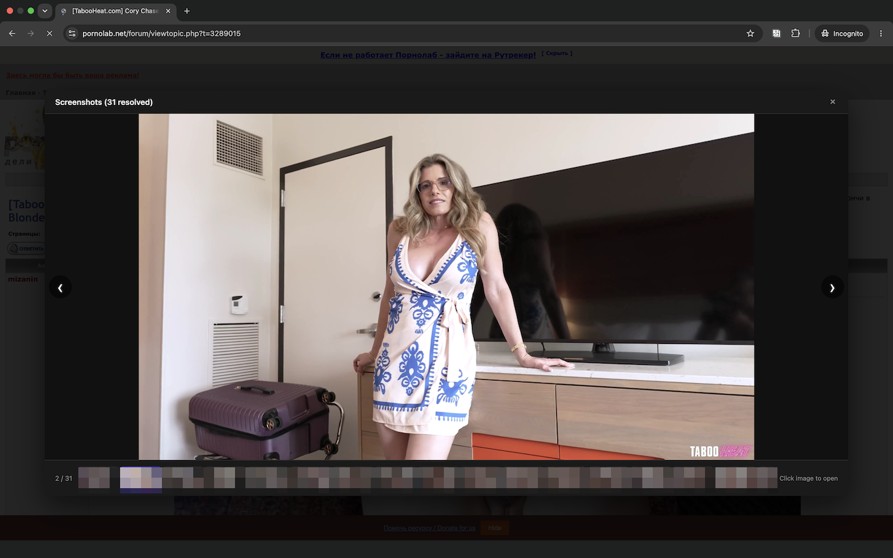

# PRNLB Viewer

PRNLB Viewer is a Chrome and Firefox extension for extracting image URLs from Pornolab and displaying the corresponding screenshots.

It has two operating modes:

- When enabled (the default), a topic page automatically opens a screenshot carousel for the first post.
- On a forum, tracker, or search-result topic list, the extension automatically adds a post-image preview and a screenshot button to each topic row. The button opens the same carousel for that topic.
- The toolbar button is an ON/OFF toggle. Turning it off closes the current viewer and restores the original topic-list markup; turning it on immediately activates the current supported Pornolab page. The setting is remembered across page loads.
- The topic-list options include an Actresses catalogue with aliases, favorites, profile-picture URLs, and Boobpedia/IAFD lookup. Actress search buttons open a new Pornolab search tab, and catalogue matches can highlight topic rows.

Image-host pages are rendered in temporary browser tabs when necessary, which allows the extension to handle hosts that depend on browser JavaScript or restrict direct requests.

For more features, see [PRNLB Browser](https://github.com/prnlb-browser), a standalone app that goes beyond the capabilities of this extension.



## Development

### Prerequisites

- [Node.js](https://nodejs.org/) v18 or newer
- npm

### Setup

```bash
npm install
```

### Build and watch

```bash
# One-time build; writes the unpacked extension to dist/
npm run build

# Rebuild automatically while editing
npm run watch
```

### Type checking

```bash
npm exec tsc -- --noEmit
```

### Signing

```bash
npm run sign
```

The build bundles `src/background.ts` and `src/content.ts`, then copies the manifest and icon into `dist/`. The `dist/` directory is generated and should be re-created by the build rather than edited directly.

## Architecture

- `src/background.ts` is the service-worker entry point and wires together the background services.
- `src/background/topicParser.ts` parses rendered Pornolab topic HTML.
- `src/background/topicPreviewService.ts` loads topic pages for list-row previews and manages their cancellation.
- `src/background/imageResolutionService.ts` resolves carousel images and manages cancellation when the requesting tab closes or navigates away.
- `src/resolvers/` contains image-host-specific resolvers.
- `src/content/carousel.ts` implements the topic-page carousel.
- `src/content/topicList.ts` implements previews and buttons in topic-list tables.
- `src/content/actresses.ts` implements the local actress catalogue and edit dialog.
- `src/tabLoader.ts` loads rendered pages in temporary tabs and supports readiness polling and abort signals.

The background/content boundary uses the message types in `src/types.ts`. Keep those actions stable when changing the UI or background services.

## Install in Chrome

1. Build the project with `npm run build`.
2. Open `chrome://extensions/`.
3. Enable **Developer mode**.
4. Click **Load unpacked**.
5. Select the generated `dist/` directory.
6. Visit a supported Pornolab page. The extension activates automatically; use the extension icon to toggle it off or on.

After making changes, run `npm run build` and click the extension card's reload button.

## Install in Firefox

1. Build the project with `npm run build`.
2. Open `about:debugging#/runtime/this-firefox`.
3. Click **Load Temporary Add-on**.
4. Select `dist/manifest.json`.
5. Visit a supported Pornolab page. The extension activates automatically; use the extension icon to toggle it off or on.

After making changes, run `npm run build` and click **Reload** next to the extension entry.

Temporary add-ons are removed when Firefox restarts. For a permanent installation, download the signed extension distribution from [Releases](https://github.com/prnlb-browser/prnlb-extension/releases).

## Download

The latest signed extension distribution is available from [Releases](https://github.com/prnlb-browser/prnlb-extension/releases).

## Support

BTC — `bc1q7q0536ctrllvf7sp0ghlw2evwz75jn7x7nzc79`  
ETH — `0x87c7CB3d62Bc70A19638A01064B2028fB89E37BF`

---

## PRNLB Viewer (Русский)

PRNLB Viewer — расширение для Chrome и Firefox, которое извлекает URL изображений со страниц Pornolab и показывает соответствующие скриншоты.

Расширение работает в двух режимах:

- На странице темы нажатие на иконку открывает карусель скриншотов первого сообщения.
- На странице списка тем форума, трекера или результатов поиска нажатие на иконку добавляет к каждой строке превью изображения и кнопку открытия скриншотов темы.

Больше возможностей доступно в [PRNLB Browser](https://github.com/prnlb-browser) — отдельном приложении с более широкой функциональностью.

### Установка в Chrome

1. Соберите проект (`npm run build`).
2. Откройте `chrome://extensions/`.
3. Включите **Режим разработчика**.
4. Нажмите **Загрузить распакованное расширение**.
5. Выберите созданную директорию `dist/`.

После изменений снова выполните `npm run build` и нажмите кнопку перезагрузки на карточке расширения.

### Установка в Firefox

1. Соберите проект (`npm run build`).
2. Откройте `about:debugging#/runtime/this-firefox`.
3. Нажмите **Загрузить временное дополнение**.
4. Выберите файл `dist/manifest.json`.

После изменений снова выполните `npm run build` и нажмите **Перезагрузить** рядом с записью расширения.

> **Примечание:** Временные дополнения удаляются при перезапуске Firefox. Для постоянной установки скачайте подписанный дистрибутив со страницы [Releases](https://github.com/prnlb-browser/prnlb-extension/releases).

### Скачать

Последний подписанный дистрибутив расширения можно скачать на странице [Releases](https://github.com/prnlb-browser/prnlb-extension/releases).

### Поддержка

BTC — `bc1q7q0536ctrllvf7sp0ghlw2evwz75jn7x7nzc79`  
ETH — `0x87c7CB3d62Bc70A19638A01064B2028fB89E37BF`
